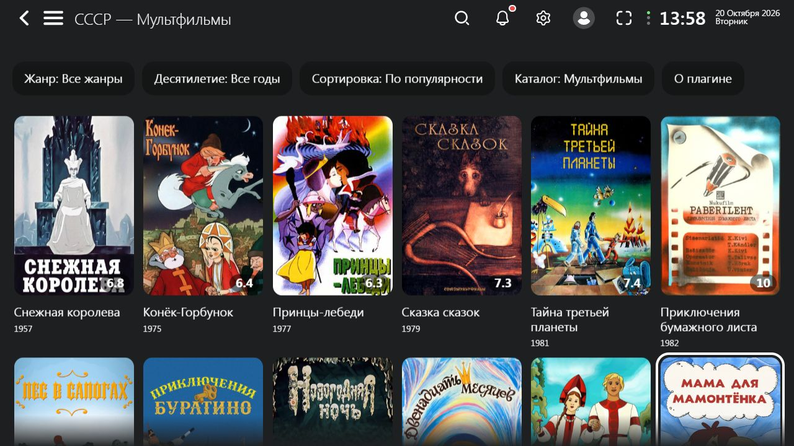
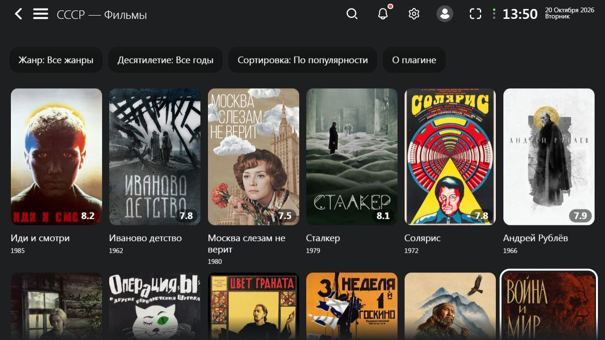
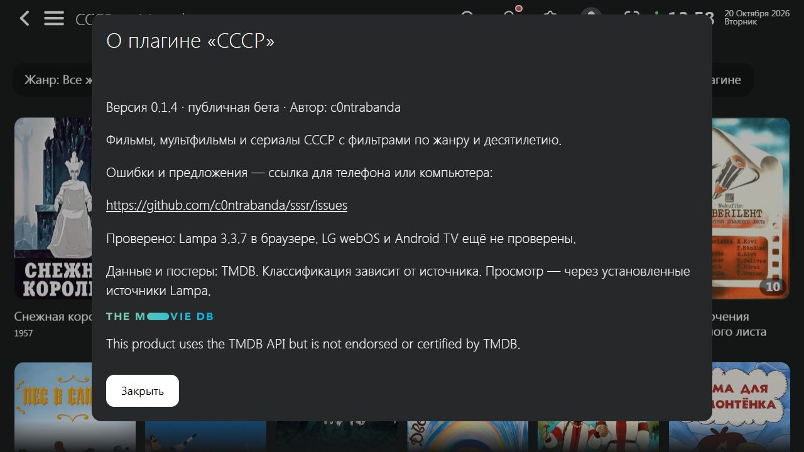

# СССР для Lampa

Публичная бета-версия **0.1.4**. Фильмы, мультфильмы и сериалы СССР по постерам, фильтры по жанру и десятилетию, пять сортировок. В мультфильмах — «Мультфильмы» и «Мультсериалы».

## Установка

В Lampa: **Настройки → Расширения → Добавить плагин**, вставить адрес:

https://c0ntrabanda.github.io/sssr/sssr.js

Перезапустить Lampa. В боковом меню появится «СССР». При обновлении уже установленного плагина перезапустите приложение; в браузере можно использовать Ctrl+F5. Проверить версию можно в кнопке «О плагине» внутри каталога.

## Изменения в 0.1.4

- В каталоге анимации два варианта: «Мультфильмы» и «Мультсериалы».
- Единственный адрес установки и обновлений: https://c0ntrabanda.github.io/sssr/sssr.js.

## Совместимость и обратная связь

Проверено в браузерной **Lampa 3.3.7**, проходят 52 автоматических теста. LG webOS и Android TV ещё требуют проверки на реальных устройствах.

Ошибки и предложения: [GitHub Issues](https://github.com/c0ntrabanda/sssr/issues). Укажите устройство, ОС, версию Lampa, шаги и результат; по возможности приложите скриншот или фото.

Каталог использует данные TMDB через настройки Lampa. Полнота и классификация зависят от источника; TV включает передачи, сортировка названий может отличаться от русского алфавита. Плагин открывает обычные карточки Lampa; просмотр зависит от уже установленных источников.

## Скриншоты

[Текст объявления](ANNOUNCEMENT.md)

## Источник данных

This product uses the TMDB API but is not endorsed or certified by TMDB.

## Проверенная сборка

SHA-256 sssr.js версии 0.1.4: EEB496D053D6D0AEE421D97D7CC636A3229E94E613D667AC109EB8C07B182BC5
