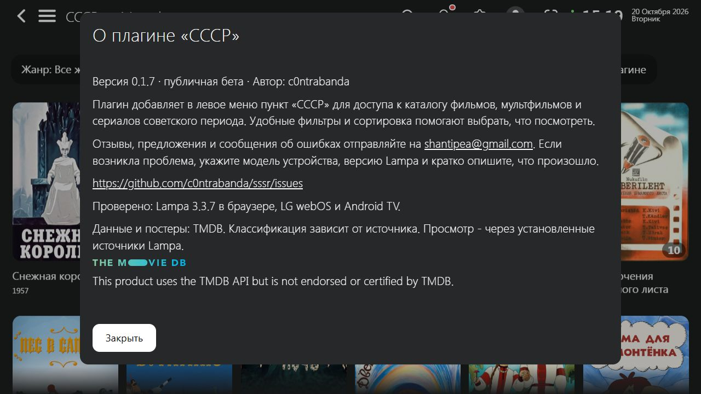

# СССР для Lampa

Публичная бета-версия **0.1.7**.

Плагин добавляет в левое меню пункт «СССР» для доступа к каталогу фильмов, мультфильмов и сериалов советского периода. Удобные фильтры и сортировка помогают выбрать, что посмотреть.

## Установка

В Lampa: **Настройки → Расширения → Добавить плагин**, вставить адрес:

https://c0ntrabanda.github.io/sssr/sssr.js

Перезапустить Lampa. В боковом меню появится «СССР». При обновлении уже установленного плагина перезапустите приложение; в браузере можно использовать Ctrl+F5. Проверить версию можно в кнопке «О плагине» внутри каталога.

## Изменения в 0.1.7

- Добавлены почта и сообщение для обратной связи.
- Адрес установки и обновлений: https://c0ntrabanda.github.io/sssr/sssr.js.

## Совместимость и обратная связь

Проверено в браузерной **Lampa 3.3.7**, проходят 52 автоматических теста. Пользователь подтвердил установку и работу на LG webOS и Android TV 20 октября 2026 года.

Отзывы, предложения и сообщения об ошибках отправляйте на [shantipea@gmail.com](mailto:shantipea@gmail.com). Если возникла проблема, укажите модель устройства, версию Lampa и кратко опишите, что произошло.

Также можно написать в [GitHub Issues](https://github.com/c0ntrabanda/sssr/issues).

Каталог использует данные TMDB через настройки Lampa. Полнота и классификация зависят от источника; TV включает передачи, сортировка названий может отличаться от русского алфавита. Плагин открывает обычные карточки Lampa; просмотр зависит от уже установленных источников.

## Скриншоты

[Текст объявления](ANNOUNCEMENT.md)

## Источник данных

This product uses the TMDB API but is not endorsed or certified by TMDB.

## Проверенная сборка

SHA-256 sssr.js версии 0.1.7: 1CD1E973DA6AA80866F759BD640BE93D08F4AE89FC9278B0A74990421936C67B
